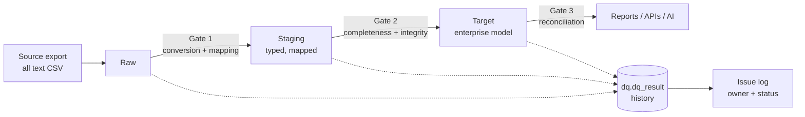

# Data Quality Starter Kit

**Automated data quality checks for any data pipeline: rules as config, results you can audit, and an issue log that says who fixes what.**

Your pipeline can run "successfully" and still load wrong data. This kit shows, in a demo you can run in one minute, how to catch that *before* it reaches your reports:

- **14 ready-made rules** covering completeness, uniqueness, validity, consistency, integrity, accuracy and volume drift
- **Quality gates** between pipeline layers: a critical failure stops the batch
- **Every result stored** (`dq.dq_run`, `dq.dq_result`) so you can show trends and prove quality to auditors
- **An issue log** (CSV, ready for Excel, Sheets or Jira) with an **owner** for each problem: data entry, ETL or source system
- **The same rules for your stack:** SQL, dbt, PySpark/Deequ, AWS Glue Data Quality, Great Expectations, Snowflake, Airflow

---

## Quick start (1 minute)

```bash
git clone https://github.com/hmakhlouf/data-quality-starter-kit.git
cd data-quality-starter-kit
pip install -r requirements.txt
python demo/generate_data.py
python dq/run_checks.py
```

Output:

```
Data quality run 3f9c1a2b7d4e: STOP

  PASS  critical RAW_001  Every record has a record_id                            rows=0
  FAIL  warn     RAW_002  start_date text converts to a real date                 rows=12
  FAIL  critical MAP_001  Every category value has a mapping                      rows=3
  FAIL  critical STG_001  program_id is filled                                    rows=6
  FAIL  critical STG_002  program_id exists in the program list (no orphans)      rows=4
  FAIL  critical REC_001  Record count matches between staging and target         rows=1
  FAIL  critical REC_002  No records lost between staging and target              rows=12
  FAIL  critical TGT_001  record_id is unique in target                           rows=15
  FAIL  critical REC_004  Totals by program match between staging and target      rows=5
  ...
  8 of 14 rules failed (7 critical).
```

Then open `output/report.md` and `output/issue_log.csv`.

## The demo

A typical migration: an all-text export (from Quickbase, Airtable, Excel or an old system) is loaded into **raw** tables, converted into typed **staging** tables, then into the **target** (enterprise) model.



`demo/generate_data.py` creates 1,000 records with realistic data entry problems (dates like `TBD` or `13/31/2025`, blank and unknown program IDs, category spellings like `Youth  Svc`). `demo/pipeline.sql` builds the three layers and contains three classic ETL bugs: an incomplete mapping table, a silent filter that drops records, and a re-run that appends duplicates.

### Why record counts are not enough

In the demo, staging has **1,000** records and the target has **1,003**. Off by 3, so it looks almost fine.
In reality, **12 records were lost** and **15 were duplicated**. Only the record-level checks (REC_002, TGT_001) and the totals by group (REC_004) show it. That's why every rule set needs counts *and* keys *and* totals.

## The rules

All rules live in [`rules/rules.yml`](rules/rules.yml). Each one is a SQL query that returns the failing rows (empty = pass), plus a severity and an owner:

```yaml
- id: TGT_001
  name: record_id is unique in target
  dimension: uniqueness
  stage: target
  severity: critical          # critical = stop the batch, warn = load and log
  owner: tech team (ETL)
  sql: |
    SELECT record_id || ' x' || CAST(COUNT(*) AS VARCHAR) AS example
    FROM tgt_program_records GROUP BY record_id HAVING COUNT(*) > 1
```

| Dimension | Rules in the kit |
|---|---|
| Completeness | record_id present, program_id filled, counts match, no lost records, ±5% volume drift |
| Uniqueness | record_id unique in target |
| Validity | dates and amounts convert, status in allowed list, amount ≥ 0 |
| Consistency | every category value has a mapping |
| Integrity | every program_id exists in the program list |
| Accuracy | row-hash compare staging vs target, totals by program |

**Add a rule:** copy a block, change the SQL, run again. No code changes.

## Use it in your pipeline

```bash
python dq/run_checks.py --no-demo --db your.duckdb --fail-on-critical
```

`--fail-on-critical` returns exit code 1 when a critical rule fails, so your orchestrator stops before publishing. See [`examples/airflow/dag_with_quality_gate.py`](examples/airflow/dag_with_quality_gate.py).

The runner uses DuckDB. For Postgres, SQL Server, Snowflake or BigQuery, swap `connect()` in [`dq/run_checks.py`](dq/run_checks.py) for that database's Python connection and adjust engine-specific functions in the rules (e.g. `TRY_STRPTIME` → `TRY_CONVERT` / `SAFE.PARSE_DATE`).

## Same rules, your stack

| Your stack | Example | Notes |
|---|---|---|
| **dbt** | [`examples/dbt/schema.yml`](examples/dbt/schema.yml), [`compare_staging_target.sql`](examples/dbt/compare_staging_target.sql) | dbt tests + model contracts + `dbt_expectations` + `audit_helper` + Elementary monitors |
| **Spark** (Databricks, EMR, Glue) | [`examples/pyspark_deequ/checks.py`](examples/pyspark_deequ/checks.py) | PyDeequ checks, joins for reconciliation, results saved as a table |
| **AWS Glue** | [`examples/aws_glue_dqdl/rules.dqdl`](examples/aws_glue_dqdl/rules.dqdl) | Glue Data Quality rules (DQDL), alerts through EventBridge/SNS |
| **Python / pandas** | [`examples/great_expectations/checks.py`](examples/great_expectations/checks.py) | Great Expectations (GX Core 1.x); runs on the demo output |
| **Snowflake** | [`examples/snowflake/data_metric_functions.sql`](examples/snowflake/data_metric_functions.sql) | Built-in Data Metric Functions + a custom one |
| **Airflow** | [`examples/airflow/dag_with_quality_gate.py`](examples/airflow/dag_with_quality_gate.py) | load → quality gate → publish |

## Principles behind the kit

1. Put checks **between layers**, not only at the end.
2. **Critical** stops the batch; **warn** loads, logs and alerts.
3. **Store every result**: trends need history, audits need proof.
4. **Every failure has an owner**: data entry, ETL or source system. This ends the "is it business or IT?" debate.
5. **Rules are config**, so your team can add one in five minutes.
6. Run checks **inside the orchestrator** you already use.

## Project layout

```
demo/            generate_data.py (sample export), pipeline.sql (raw -> staging -> target)
rules/           rules.yml: all checks as config
dq/              run_checks.py: runner, results store, issue log, report
examples/        dbt, PySpark/Deequ, AWS Glue DQDL, Great Expectations, Snowflake, Airflow
output/          report.md, issue_log.csv, demo.duckdb (generated)
```

## About

Built by [Hocine Makhlouf](https://www.linkedin.com/in/hmakhlouf/), Data Engineer based in Mannheim, Germany.

This kit is based on the data quality approach I used in production: automated SQL checks between raw, staging and golden tables, record counts held within ±5% of the last run, and failed batches stopped before anything reached downstream systems.

## License

MIT © 2026 Tassili Technology
